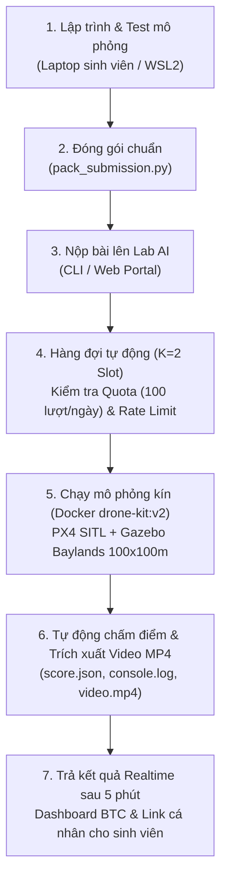

# Hướng Dẫn Kỹ Thuật Luyện Tập Tại Nhà & Quy Trình Nộp Bài Vòng 1 — AI Drone Challenge FA26

- **Ngày ban hành:** 15/10/2026.
- **Áp dụng cho:** 35 đội thi Vòng 1 (Sơ loại) — AI Drone Challenge FA26.
- **Hệ thống chấm trực tuyến:** Máy chủ Lab AI (RTX 4080 Super 16GB, RAM 64GB) qua Cloudflare Tunnel:
  - **Trang chủ & Live Dashboard:** `https://fptuqn-drone-challenge-2026.appnext.space/dashboard`
  - **Xem kết quả cá nhân:** `https://fptuqn-drone-challenge-2026.appnext.space/result/<MÃ_ĐỘI>`
  - **Xem & Tải video chuyến bay:** `https://fptuqn-drone-challenge-2026.appnext.space/video/<MÃ_ĐỘI>`

---

## 1. Kiến Trúc Hoạt Động & Quy Trình Khép Kín

Hệ thống cho phép sinh viên phát triển thuật toán tại nhà trên máy cá nhân (Windows WSL2 hoặc Linux), sau đó đóng gói nộp lên hệ thống chấm tự động của Lab AI để nhận điểm và video chuyến bay:



---

## 2. Hướng Dẫn Sinh Viên Chạy Thử Trên Máy Cá Nhân (Laptop Windows WSL2)

Bộ kit hỗ trợ cả hai môi trường: **Docker Kit (`drone-kit:v2`)** và **Môi trường Native (`drone-setup/` theo file `AGENT_SETUP.md`)**. Cả hai đều điều khiển drone qua chung một giao thức **MAVLink UDP 14540**.

### 2.1. Cấu trúc bộ mã nguồn mẫu (`student-starter-kit/`)
Sinh viên tải thư mục mẫu `student-starter-kit/` gồm các file:
- **`solution.py`**: Mã nguồn chính điều khiển drone bay quét zíc-zắc $100\text{ m} \times 100\text{ m}$ (độ cao $12\text{m}$, vận tốc $3.5\text{ m/s}$), có chú thích sẵn vị trí tích hợp mô hình YOLO và gọi hàm báo cáo nạn nhân.
- **`victim_report.py`**: Thư viện chuẩn BTC cấp, chứa hàm `report_person(...)` để ghi nhận tọa độ nạn nhân $(X_{\text{North}}, Y_{\text{East}})$. Tự động tương thích cả khi chạy trong Docker lẫn Native.
- **`pack_submission.py`**: Tool tự động kiểm tra cú pháp Python, kiểm soát dung lượng $\le 30\text{ MB}$, đóng gói `.tar.gz` kèm SHA-256 và upload lên server.
- **`README.md`**: Hướng dẫn thao tác nhanh cho đội thi.

### 2.2. Khởi động mô phỏng bằng 1 lệnh duy nhất (`launch_sim.sh`)
Đối với sinh viên sử dụng WSL2 theo hướng dẫn `AGENT_SETUP.md`:
1. Mở Terminal WSL 1:
   ```bash
   cd ~/Workspace/260727-drone-setup
   ./launch_sim.sh
   ```
   *(Script tự động chạy ngầm MicroXRCEAgent, PX4 SITL, Gazebo Harmonic bản đồ Baylands ở chế độ `HEADLESS=1` siêu nhẹ máy, gỡ chặn an toàn `NAV_DLL_ACT=0` và kết nối Camera Bridge sang ROS 2).*
2. Mở Terminal WSL 2 để chạy thử thuật toán:
   ```bash
   cd ~/Workspace/260810-drone-kit/student-starter-kit
   python3 solution.py
   ```
   - Drone sẽ tự động cất cánh, bay quét theo các waypoint zíc-zắc và hạ cánh an toàn.
   - Xem camera trực tiếp tại: `http://localhost:8080` (hoặc `http://localhost:8081`).
3. Khi dừng thử nghiệm: Tại Terminal 1 chỉ cần nhấn **`Ctrl + C`**, script sẽ tự dọn sạch 100% các tiến trình ngầm, không làm nóng máy hay tốn RAM laptop.

---

## 3. Sinh Viên Cần Code Ở Những Phần Nào?

Sinh viên chỉ cần tập trung vào **3 nhiệm vụ chính** trong file `solution.py`:

1. **Chiến thuật bay & Quy hoạch quỹ đạo (Navigation):**
   - Tinh chỉnh độ cao `ALTITUDE` (Bắt buộc trong hành lang an toàn: $8\text{m} \le H \le 20\text{m}$).
   - Tinh chỉnh vận tốc `SPEED` (Khuyến nghị $3.0 - 4.5\text{ m/s}$ để tránh quán tính lật nghiêng drone ở góc cua 180°).
   - Tinh chỉnh khoảng cách làn `LANE_SPACING` (Đảm bảo độ phủ gối biên $\ge 20\%$).
2. **Nhận diện nạn nhân bằng AI (YOLO Detection):**
   - Nạp model YOLOv8n / YOLOv8s hoặc **custom weights** `.pt` / `.onnx` (toàn bộ gói nộp $\le 30\text{ MB}$).
   - **Bắt buộc copy file model vào thư mục bài làm trước khi pack:** container chấm chạy `--network none`, không `pip install` / tải weights từ mạng lúc thi.
   - Khi nộp, có thể khai báo qua manifest: `python3 pack_submission.py --team-id T05 --env YOLO_WEIGHTS=my_model.pt --env KIT_YOLO=1`.
   - Trong `solution.py` có thể đọc `os.environ['YOLO_WEIGHTS']` nếu đội tự chạy inference; node YOLO nền của kit cũng nhận biến này từ manifest khi chấm.
   - Lọc nhiễu bounding box và trích xuất độ tin cậy (`confidence >= 0.5` hoặc ngưỡng đội chọn).
3. **Ước tính tọa độ & Gửi báo cáo:**
   - Chiếu tâm ảnh 2D sang tọa độ mặt đất 3D $(X_{\text{North}}, Y_{\text{East}})$ dựa vào độ cao và góc camera.
   - Gọi hàm báo cáo chuẩn do BTC cung cấp:
     ```python
     from victim_report import report_person

     report_person(
         north_m=cur_x,
         east_m=cur_y,
         confidence=float(conf),
         sim_s=current_sim_time
     )
     # Hoặc báo cáo theo tọa độ GPS:
     # report_person(lat=cur_lat, lon=cur_lon, confidence=float(conf), sim_s=current_sim_time)
     ```

### 3.1. Dữ liệu gửi về Server & Cơ chế ghi nhận
- **Cấu trúc bản ghi JSONL:** Mỗi khi hàm `report_person(...)` được gọi, hệ thống sẽ ghi ngay một dòng vào file `/student/output/reports.jsonl`:
  ```json
  {"north_m": 92.85, "east_m": 11.42, "confidence": 0.57, "sim_s": 24.3, "frame_id": null}
  ```
  - `north_m`, `east_m`: Tọa độ mặt đất tính bằng mét so với điểm cất cánh của drone (khớp hệ tọa độ NED của PX4). Nếu truyền `lat`, `lon` (độ thập phân GPS), thư viện tự động quy đổi sang mét tương đối so với tọa độ gốc bãi bay.
  - `confidence`: Điểm tin cậy từ model AI (từ `0.0` đến `1.0`).
  - `sim_s`: Thời gian mô phỏng (giây). Dùng để Grader loại bỏ các báo cáo gửi muộn (late reports) sau khi hết giờ thi.
- **Cơ chế Streaming liên tục:** Dữ liệu được `flush` ngay vào file khi phát hiện, **không cần chờ drone hạ cánh mới gửi**. Khi kết thúc bài bay, Grader tự động đọc toàn bộ danh sách để chấm điểm.

### 3.2. Cơ chế xử lý Trùng lặp & Báo sai (False Positive)
- **1 vật thể bị gửi 2 lần lệch nhau một chút:**
  - Thuật toán Grader sử dụng phương pháp ghép cặp tham lam (Greedy Distance Matching) trong bán kính xét $10\text{m}$.
  - Lần gửi đầu tiên khớp với nạn nhân sẽ được tính là **True Positive (TP — Có điểm)**.
  - Lần gửi thứ hai rơi vào cùng nạn nhân đó sẽ được coi là **Duplicate (Trùng lặp)**: không được cộng thêm điểm nhưng cũng **không bị phạt**.
- **Gửi đúng vị trí nhưng sai vật thể (ví dụ nhầm xe ô tô/SUV thành người):**
  - Ground Truth bài thi chỉ ghi nhận vị trí nạn nhân (**Person**).
  - Nếu báo cáo không có bất kỳ nạn nhân nào trong bán kính $10\text{m}$, hệ thống tính là **False Positive (FP — Báo rác)**.
  - **Hình phạt:** Mỗi điểm FP sẽ bị **trừ $0.5$ lần điểm đúng** ở phần AI và làm tụt tỉ lệ Precision ở phần Tọa độ. Đội thi cần xây dựng thuật toán lọc nhiễu (Deduplication / Clustering) kỹ càng trước khi báo cáo.

### 3.3. Đảm bảo Cô lập & Không bao giờ lẫn lộn giữa các đội thi
Hệ thống chấm thi tự động áp dụng 3 tầng cô lập độc lập cứng:
1. **Cô lập File System (Volume Mount riêng biệt):** Mỗi đội chạy trong workspace riêng biệt `grading/runs/<team>/workspace:/student`. Tiến trình container đội này tuyệt đối không thể đọc hay ghi đè lên file của đội khác.
2. **Cô lập Mạng & ROS2 (Domain ID & Gazebo Partition):** Mỗi slot thi đấu được cấp một `ROS_DOMAIN_ID = 20 + slot_idx` và phân vùng Gazebo riêng biệt. Mạng container chạy ở chế độ cô lập, không broadcast ra mạng LAN.
3. **Cô lập Telemetry & Video:** Container sidecar recorder đính kèm trực tiếp vào container mạng của chính đội đó, đảm bảo log telemetry và video MP4 lưu độc lập 100%.

### 3.4. Cấu trúc Ground Truth & Quy định Điểm cất cánh của Drone
- **Cấu trúc lưu trữ Ground Truth của BTC:**
  - File đáp án chuẩn (`ground_truth_210.json`) được lưu dạng JSON chứa gốc tham chiếu `origin` (GPS của bãi cất cánh), vị trí spawn `spawn_world_xy: [0, 0]` và danh sách tọa độ của toàn bộ **150 nạn nhân** theo trục Bắc/Đông `(north_m, east_m)` tính bằng mét so với bãi cất cánh.
  - Grader hỗ trợ đối chiếu linh hoạt 3 hệ tọa độ từ báo cáo của thí sinh:
    1. `north_m`, `east_m`: Tọa độ NED mét so với điểm cất cánh.
    2. `lat`, `lon`: Tọa độ GPS độ thập phân (Grader tự động chiếu sang NED theo công thức trắc địa Haversine/Equirectangular quanh tọa độ `origin`).
    3. `x`, `y`: Tọa độ thế giới Gazebo ENU.
- **Quy định vị trí cất cánh (Spawn Point):**
  - **Drone luôn xuất phát tại 1 vị trí cố định duy nhất:** Tọa độ Gazebo $(X=0, Y=0, Z=0)$ tương ứng GPS Home `lat = 37.412173, lon = -121.998878`. Điều này đảm bảo tính công bằng tuyệt đối (Fairness) cho tất cả 35 đội thi. Sinh viên **không được phép đổi vị trí spawn** của container.
- **Chiến thuật bay đến vị trí khác trước khi quét:**
  - Đội thi **hoàn toàn có thể lập trình trong code** để drone cất cánh lên độ cao an toàn, bay thẳng với vận tốc cao ($5 - 6\text{ m/s}$) đến một phân vùng mong muốn (ví dụ góc Tây Bắc $N=+80\text{m}, E=-80\text{m}$) rồi mới bắt đầu hạ thấp quét tìm kiếm.
  - **Lưu ý:** Dù drone đang ở bất cứ đâu trên bản đồ, giá trị `north_m` và `east_m` gửi về **vẫn luôn là khoảng cách mét so với điểm cất cánh ban đầu (Home $(0, 0)$)** — chính là giá trị `msg.x` và `msg.y` do PX4 MAVLink `LOCAL_POSITION_NED` cung cấp.

---

## 4. Quy Định & Giới Hạn Kỹ Thuật (Anti-Cheat & Resource Guard)

1. **Dung lượng bài nộp:** Toàn bộ code + file model weights (`.pt`/`.onnx`) phải **$\le 30\text{ MB}$**.
2. **Môi trường cô lập mạng (`--network none`):**
   - Khi chạy chấm trên Lab AI, container bị ngắt kết nối mạng hoàn toàn.
   - **Tuyệt đối không dùng lệnh `pip install` hay `git clone` lúc runtime.** Mọi thư viện chuẩn (`torch`, `ultralytics`, `opencv`, `numpy`, `pymavlink`, `scipy`) đã được cài sẵn trong image `drone-kit:v2`.
3. **Giới hạn thời gian bài thi:**
   - Tối đa **8 phút thời gian mô phỏng (Sim Time)** hoặc **10 phút thời gian thực (Wall Time)**.
   - Quá thời gian trên, hệ thống sẽ ngắt cưỡng chế bài thi và tính điểm trên các báo cáo đã ghi nhận trước đó.
4. **Hạn ngạch & Rate Limit chống spam:**
   - **Hạn ngạch ngày:** Mỗi đội tối đa **100 lượt test / ngày** (tự động reset vào 00:00 UTC+7).
   - **Rate Limit chống nghẽn:** Trong vòng **1 phút chỉ được upload tối đa 1 lần**, trong **5 phút tối đa 2 lần**. Nộp quá nhanh sẽ nhận thông báo lỗi HTTP 429 và số giây cần chờ.
   - **Admin Bypass:** Ban tổ chức dùng header `X-Admin-Key` hoặc cờ `--admin-key` để test liên tục không giới hạn.

---

## 5. Quy Trình Nộp Bài & Nhận Kết Quả

### 5.1. Đóng gói & Nộp bài bằng CLI
Tại thư mục bài làm, sinh viên chạy lệnh:
```bash
python3 pack_submission.py --team-id <MÃ_ĐỘI> --entry solution.py --upload https://fptuqn-drone-challenge-2026.appnext.space
```
*(Ví dụ đội T05: `python3 pack_submission.py --team-id T05 --entry solution.py --upload https://fptuqn-drone-challenge-2026.appnext.space`)*

**Ẩn khung bounding box trên video trả về** (vẫn giữ HUD telemetry):

```bash
python3 pack_submission.py --team-id T05 --no-bbox --upload https://fptuqn-drone-challenge-2026.appnext.space
```

Cờ `--no-bbox` ghi `KIT_DRAW_BBOX=0` trong `manifest.json`; luồng ghi `video.mp4` dùng ảnh camera thô + OSD, không overlay box YOLO.

### 5.2. Nhận kết quả và Xem video
Sau khi nộp khoảng 5 – 7 phút:
1. **Xem điểm qua dòng lệnh (CLI):**
   ```bash
   python3 pack_submission.py --team-id T05 --status https://fptuqn-drone-challenge-2026.appnext.space
   ```
2. **Xem chi tiết trên Web:**
   Truy cập: `https://fptuqn-drone-challenge-2026.appnext.space/result/T05`
   - Hiển thị bảng điểm chi tiết: Điểm AI (max 50), Điểm Tọa độ (max 30), Điểm An toàn (max 20).
   - Hiển thị 20 dòng log cuối cùng có kèm **Timestamp `[HH:MM:SS]`** để sửa lỗi code nếu bị crash.
3. **Xem & Tải Video MP4:**
   Truy cập: `https://fptuqn-drone-challenge-2026.appnext.space/video/T05`
   - Xem video MP4 góc nhìn drone có HUD thời gian thực (mặc định có khung YOLO; nộp với `--no-bbox` nếu chỉ muốn HUD + cảnh quan).

---

## 6. Vận Hành Dành Cho Ban Tổ Chức (BTC)

### 6.1. Khởi động Server Chấm Tự Động Toàn Diện
Chạy trên terminal máy chủ Lab AI:
```bash
python3 /home/khoand96/Workspace/260810-drone-kit/scripts/grading/server_receiver.py serve \
  --port 8765 \
  --auto-eval \
  --viewer-port 18081
```

### 6.2. Quản lý Quota cho các đội thi
- Xem danh sách số lượt test đã dùng trong ngày:
  ```bash
  python3 /home/khoand96/Workspace/260810-drone-kit/scripts/grading/manage_quota.py list
  ```
- Cấp thêm lượt cho đội (ví dụ cấp thêm 50 lượt cho đội T05):
  ```bash
  python3 /home/khoand96/Workspace/260810-drone-kit/scripts/grading/manage_quota.py grant --team T05 --amount 50
  ```

### 6.3. Chiếu Live Dashboard Hội Trường
Mở trình duyệt trên máy chiếu:
👉 **`https://fptuqn-drone-challenge-2026.appnext.space/dashboard`**
- Giao diện Dark mode hiển thị Bảng xếp hạng Top 10 và Live Feed sự kiện có thanh cuộn riêng (`custom scrollbar`).
- Tự động hiển thị Toast thông báo và viền phát sáng khi có đội nộp bài mới.
- Hiển thị tiến độ chấm thời gian thực của Slot 1 / Slot 2 và hàng đợi chờ.
